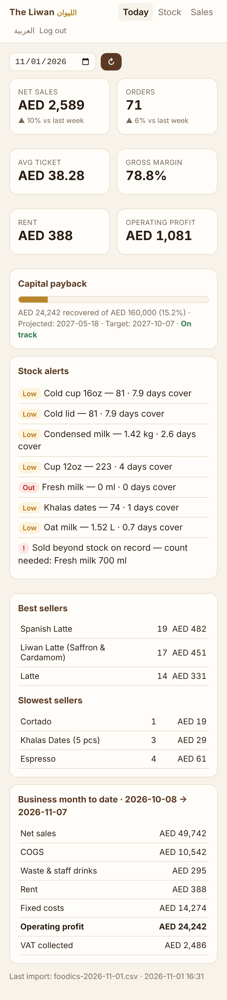
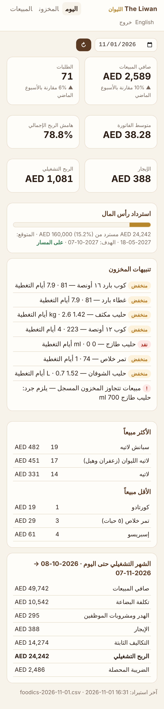
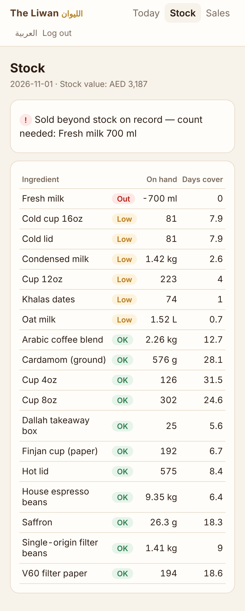
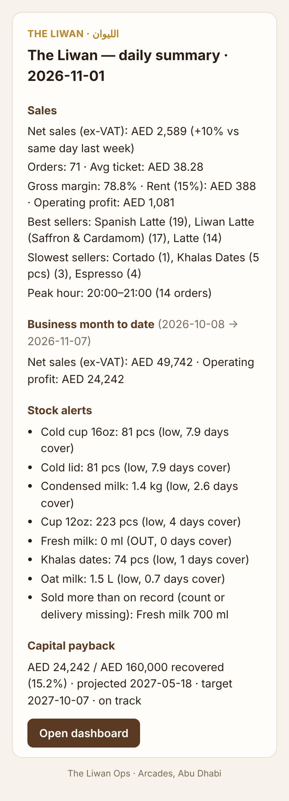

# The Liwan Ops · الليوان

A multi-agent operations system for **The Liwan**, a heritage Emirati specialty coffee kiosk at Arcades, Abu Dhabi.
It tracks stock at recipe level, analyses sales, runs the P&L and capital-payback maths, and sends owners a daily
9pm summary and a Sunday weekly report by email (WhatsApp optional). Anything that spends money or contacts a supplier needs an owner's approval.

**Status: Phase 3.**

- **Phase 1:** inventory and sales from a Foodics CSV.
- **Phase 2:** purchasing with owner approvals, VAT and the cash-flow forecast.
- **Phase 3:** staff rota, hours and payroll for the 8th (with owner approval).
See [docs/ARCHITECTURE.md](docs/ARCHITECTURE.md) for the design and the phase plan.

<p>



</p>

## Install for real (computer at the café or at home)

```bash
npm install
npm run setup      # owners, emails, language, PINs, email account, opening stock → sends a test email
npm start          # dashboard + 21:00 daily / Sunday weekly reports
```

Full guide, including auto-start, phone access and backups: [docs/run-on-a-computer.md](docs/run-on-a-computer.md).

## Try the demo (simulated October sales)

```bash
npm install
cp .env.example .env            # add ANTHROPIC_API_KEY to use the agents
npm run seed                    # menu, recipes, suppliers, owners + simulated trading 8–31 Oct 2026
npm run liwan -- import samples/foodics-2026-11-01.csv   # a day of Foodics sales → stock depletes
npm run liwan -- summary        # tonight's daily summary (add --lang ar for Arabic)
npm run liwan -- pnl            # business-month-to-date P&L
npm test                        # 156 tests: depletion, VAT, rent, pro-rating, P&L, payback, importer
```

Dashboard (phone-friendly, EN/AR):

```bash
npm run liwan -- owner --name "Partner 1" --pin 1234 --phone +971501234567
npm run dev                     # http://localhost:8787, also starts the 21:00 / Sunday scheduler
```

Ask the agent team (needs `ANTHROPIC_API_KEY`):

```bash
npm run liwan -- ask "What should we reorder before the weekend?" --verbose
npm run liwan -- ask "ما هو أقل مشروب مبيعاً هذا الأسبوع وهل هامشه جيد؟"
npm run liwan -- summary --send          # daily summary + agent insights → owners on WhatsApp
```

## Commands

| Command | What it does |
|---|---|
| `setup` | Guided first-time setup on the computer that runs it |
| `seed [--reset] [--empty]` | Demo database with simulated history (or `--empty`: menu/recipes/suppliers only) |
| `import <file.csv>` | Import a Foodics order-items export. Re-importing the same file is refused, and orders already on record are skipped |
| `stock` | Stock on hand, reorder points, days of cover, expiry |
| `sales [--from --to]` | Sales, best/worst sellers, margin per item, orders by hour |
| `pnl [--from --to]` | Profit & loss (default: business month to date, 8th → 7th) |
| `summary [--weekly] [--send] [--no-agent] [--lang ar]` | Daily summary / weekly report |
| `ask "<question>"` | Orchestrator, which routes to the Inventory or Sales agent |
| `receive <ingredient> <packs>` | Log a supplier delivery |
| `waste <ingredient> <qty> [--reason staff_drink]` | Log waste, staff drinks, samples |
| `count <ingredient> <qty>` | Physical count, books the difference |
| `expire` | Write off expired lots as waste |
| `owner --name … [--email] [--phone] [--pin] [--locale ar] [--rename]` | Owner contact, dashboard PIN, language |
| `owners` / `test-email <addr>` | See who receives reports / check SMTP |
| `serve` | Dashboard + scheduler |
| `reorder [--dry-run]` | Draft purchase orders for anything at its reorder point (they wait for approval) |
| `approvals` · `approve <id> --owner N` · `reject <id> --owner N` | Review and decide. Any one owner can approve |
| `orders` · `order <po>` · `sent <po>` · `received <po>` | Track orders, mark manual sends, book deliveries into stock |
| `suppliers` · `supplier --name N --email … [--lead-days] [--min-order]` | Supplier contacts and terms |
| `vat` · `forecast` · `cash --balance AED` | VAT this quarter, 13-week cash forecast, record bank + till balance |
| `staff` · `staff add …` · `staff update …` | Staff and their packages (basic, housing, transport, other), rest day, IBAN |
| `rota [--week D] [--generate]` · `assign <date> <open/close> <name>` | Weekly rota; auto-fill respects rest days and the 48-hour week |
| `shift <id> --status sick/absent/leave` · `hours` | Record what actually happened; hours, overtime, absences |
| `payroll` · `payroll prepare` · `payroll adjust` · `payroll paid <run>` | Preview, draft for approval, bonuses/deductions, mark paid |

Drop Foodics CSVs into `data/inbox/`. They are imported automatically at 20:55, before the 21:00 summary.

### Purchasing and approvals

1. Every hour, and right after the nightly import, the system checks stock against reorder points. It drafts one
   purchase order per supplier (Windmill, Biru, Goldbox) and emails the owners.
2. Any one owner opens **Approvals** in the dashboard and taps **Approve** or **Reject**. Nothing reaches a supplier
   before that.
3. Approved orders are emailed to the supplier. If there's no supplier email on record, you get the message to
   send by WhatsApp yourself, then tap **Mark as sent**.
4. When the delivery arrives, tap **Delivery arrived**. Stock goes up at the order's prices, and input VAT is recorded.

### Staff and payroll

- **Rota:** every Thursday, next week's rota is filled in automatically. The owners get an email listing any shift
  nobody can cover; on the **Staff** page you can assign someone who's free.
- **Hours:** shifts count as worked unless an owner marks someone **sick**, **absent** or **on leave**, or edits the
  times. Overtime is anything over 8 hours a day.
- **Payroll:** on the 6th, payroll for the month ending the 7th is drafted. Joiners and leavers are prorated,
  overtime is paid at +25% (+50% at night), unpaid absence is deducted, and bonuses or advances are applied.
  - Any one owner approves it under **Approvals**.
  - Approval writes a payment sheet (CSV) for your bank or WPS agent. Nothing is transferred automatically.
  - Tap **Mark as paid** after the transfer.
  - If shifts change while the payroll is waiting, it's recalculated, so owners never approve old numbers.
- **P&L:** once staff are added, the P&L uses their real packages plus an end-of-service gratuity estimate, instead
  of the placeholder salary line.

## Before using real numbers

The seed data is **illustrative**. Edit [`src/seed/data.ts`](src/seed/data.ts) and re-seed, or update the tables directly:

- supplier pack prices and which supplier carries what
- salaries, machine lease amount, other fixed costs
- menu prices, recipes (grams/ml per drink)
- owner names (`owner --name "Partner 1" --rename "…"`)

Then compare one real Foodics export against [`src/importers/foodics-csv.ts`](src/importers/foodics-csv.ts).
Column names are matched by alias, so add any header your export uses to `COLUMNS`.

## Where the reports go

Reports go to every owner on every channel that's set up:

| Channel | Setup | Status |
|---|---|---|
| **Email** | [docs/email.md](docs/email.md): Gmail app password, about 5 minutes | Recommended to start |
| WhatsApp | [docs/whatsapp.md](docs/whatsapp.md): Meta Business number + approved templates | Add later; runs alongside email |

```bash
npm run liwan -- owner --name "Partner 1" --email partner1@example.com --locale en
npm run liwan -- owners                     # who gets what, and which channels are active
npm run liwan -- test-email you@example.com
npm run liwan -- summary --send --no-agent  # send tonight's summary now
```

If no channel is configured, summaries print to the console.


